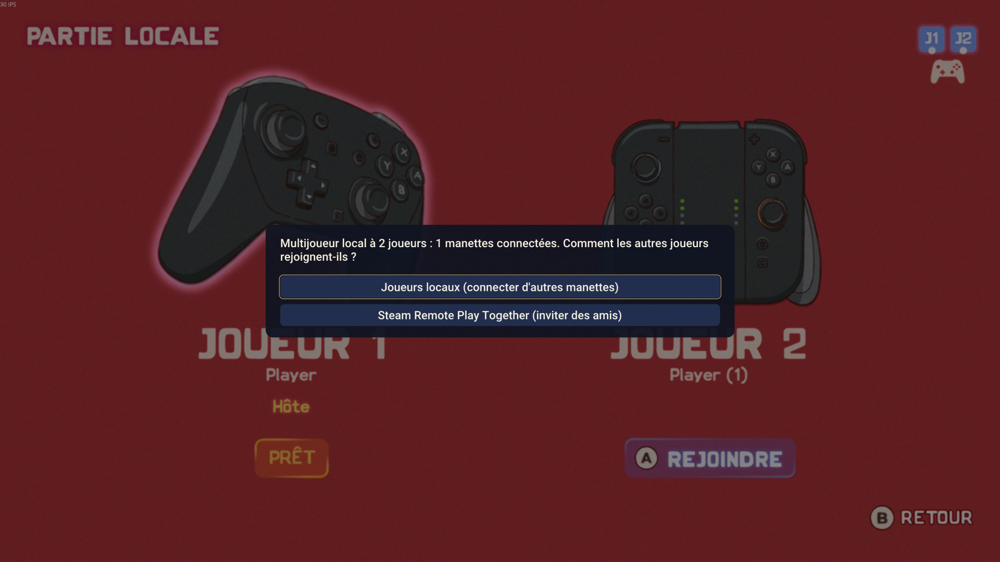

# Orbitals Together

[English](README.md) · **Français**

**Orbitals Deluxe Edition sur PC, à deux : côte à côte, avec Steam Remote Play Together, ou en ligne dans le navigateur d'un ami.**

Orbitals Together est une recompilation statique d'Orbitals Deluxe Edition (Nintendo Switch 2) pour Windows : le code
du jeu est recompilé pour PC à partir de **votre propre copie du jeu**, et le rendu passe par Vulkan. Il n'y a ni
émulateur, ni fichier du jeu dans ce dépôt.

- Version actuelle : **0.4.0**
- Jeu pris en charge : **Orbitals Deluxe Edition 1.0.5**
- Système : Windows 10 ou 11, 64 bits

Ce dépôt contient les builds considérés comme définitifs et le code source complet de chaque version : tout le monde
peut le forker pour l'améliorer (voir la partie 8). Le développement quotidien et les builds de test se font sur
[sinedgiveaways/pmocer-latibro](https://github.com/sinedgiveaways/pmocer-latibro).

---

## Sommaire

1. [Ce qu'il vous faut](#1-ce-quil-vous-faut)
2. [Télécharger le build](#2-télécharger-le-build)
3. [Installer et recompiler le jeu](#3-installer-et-recompiler-le-jeu)
4. [Jouer à deux en local](#4-jouer-à-deux-en-local)
5. [Partie locale avec un ami à distance : Steam Remote Play Together](#5-partie-locale-avec-un-ami-à-distance--steam-remote-play-together)
6. [Partie en ligne dans un navigateur](#6-partie-en-ligne-dans-un-navigateur)
7. [En cas de problème](#7-en-cas-de-problème)
8. [Forker et améliorer le projet](#8-forker-et-améliorer-le-projet)

---

## 1. Ce qu'il vous faut

- Un PC sous **Windows 10 ou 11 (64 bits)**.
- Une **carte graphique compatible Vulkan 1.3** (NVIDIA, AMD ou Intel récente) avec ses derniers pilotes.
- Environ **30 Go d'espace libre**.
- **Votre propre copie d'Orbitals Deluxe Edition, en version 1.0.5**, extraite de votre console Switch 2 :
  - soit un fichier **`.nup`** ;
  - soit les dossiers **`exefs`** et **`romfs`**.

  Le jeu n'est pas fourni et ne le sera jamais : vous devez posséder le jeu et l'extraire vous-même.
- Une connexion Internet pendant l'installation (des outils de NVIDIA, environ 130 Mo, sont téléchargés pour traduire
  les shaders du jeu).
- Pour jouer avec un ami à distance par Steam : **Steam** installé et connecté (voir la partie 5). La partie en ligne
  dans un navigateur ne demande rien de plus (voir la partie 6).

## 2. Télécharger le build

1. Ouvrez la page des versions : **[Releases](https://github.com/sinedgiveaways/Orbitals-Together/releases/latest)**.
2. Téléchargez le fichier **`orbitals-together-0.4.0-windows-x64.zip`**.
3. Décompressez-le, par exemple dans `C:\Users\<vous>\Downloads\`. Le zip crée un dossier
   **`orbitals-together`**, qui sera le dossier du jeu. Évitez `C:\Program Files` : le programme écrit ses fichiers
   dans son propre dossier.

Le dossier contient `orbitals-together.exe`, ses bibliothèques, `steam_api64.dll` et un dossier `setup\` (les outils
qui recompilent le jeu). Ne déplacez rien à l'intérieur.

## 3. Installer et recompiler le jeu

La recompilation se fait **une seule fois**, sur votre PC, depuis le lanceur.

1. Lancez **`orbitals-together.exe`**. Le lanceur s'ouvre.
2. Choisissez **Fichiers du jeu**.
3. Sous **Votre copie**, indiquez où se trouve votre copie du jeu :
   - **Choisir un fichier .nup ou .nx** pour un fichier `.nup`,
   - ou **Choisir le dossier** pour le dossier qui contient `exefs` et `romfs`.
4. Pour **RomFS (23 Go)**, choisissez **Copier dans le dossier du jeu** (conseillé) ou **L'utiliser là où il est**
   (pas de copie, mais votre copie du jeu doit rester à sa place).
5. Cliquez sur **Préparer**. Le lanceur affiche chaque étape :
   1. **vérification** : la version du jeu doit être Orbitals Deluxe Edition 1.0.5 ;
   2. **copie** de `exefs` puis de `romfs` (environ 23 Go) ;
   3. **génération** du code du jeu en C ;
   4. **compilation** de ce code pour votre PC (l'étape la plus longue) ;
   5. **traduction des shaders** pour votre carte graphique ;
   6. **préchauffage** : le jeu tourne une minute tout seul pour préparer les pipelines graphiques ;
   7. **nettoyage**.

   Comptez de 20 minutes à plus d'une heure selon votre processeur. Si vous arrêtez en cours de route, la préparation
   reprend à la dernière étape terminée.
6. Quand c'est fini, le lanceur affiche en bas à gauche **« Fichiers du jeu prêts (Orbitals Deluxe Edition 1.0.5) »**.
7. Revenez à l'écran d'accueil et cliquez sur **Jouer**.

Pendant le jeu, **F1** au clavier ou **Start + Select** à la manette ouvre le menu des paramètres (écran, graphismes,
son, commandes, langue).

## 4. Jouer à deux en local

1. Branchez **deux manettes** (Xbox, PlayStation ou autre manette reconnue par Windows).
2. Lancez le jeu et choisissez **Partie locale**. Chaque manette est un joueur.

Le jeu se joue à 2 joueurs au maximum.

## 5. Partie locale avec un ami à distance : Steam Remote Play Together

Steam diffuse l'image et le son du jeu à votre ami, et sa manette (ou son clavier) devient le joueur 2. **Votre ami n'a
pas besoin du jeu**, seulement de Steam (ou de l'application Steam Link, ou d'un navigateur avec un lien invité).

Le jeu passe par un jeu Steam gratuit qui prend en charge Remote Play Together : **RetroArch** (App ID `1118310`).
Steam pense lancer RetroArch, mais c'est Orbitals Together qui démarre. Vos amis voient donc « RetroArch » dans Steam.

### Une seule fois : la configuration

1. Dans Steam, installez **RetroArch** (gratuit) depuis la boutique.
2. Dans votre bibliothèque Steam : clic droit sur **RetroArch** > **Propriétés** > **Général** > **Options de
   lancement**, puis écrivez le chemin de `orbitals-together.exe` entre guillemets, suivi de `%command%` :

   ```
   "C:\Users\<vous>\Downloads\orbitals-together\orbitals-together.exe" %command%
   ```

   Remplacez le chemin par celui de votre dossier.
3. Dans le dossier du jeu, ouvrez (ou créez) le fichier **`orbitals.ini`** avec le Bloc-notes et ajoutez :

   ```ini
   [steam]
   steam_appid = 1118310
   ```

   Le même réglage existe dans le menu : **Paramètres > Jeu > Steam Remote Play Together > ID d'application Steam**.
4. Vérifiez que **`steam_api64.dll`** est bien à côté de `orbitals-together.exe` (il est dans le zip).

### À chaque partie

1. Lancez le jeu, depuis son dossier (`orbitals-together.exe`) ou par le bouton **Jouer** de RetroArch dans Steam.
   Steam doit être ouvert, et les options de lancement de RetroArch (étape 2 de la configuration) doivent être en
   place : sans elles, la manette de votre ami n'arrive pas au jeu.
2. Dans le menu du jeu, choisissez **Partie locale** avec votre seule manette : le jeu demande comment les autres
   joueurs rejoignent ; choisissez **Steam Remote Play Together (inviter des amis)** et **invitez votre ami** dans la
   liste Steam. (Vous pouvez aussi passer par le menu F1 > Jeu > **Inviter des amis**, ou **Copier le lien invité**
   pour un ami sans Steam.)
3. Quand votre ami a rejoint et appuyé sur un bouton de sa manette, lancez une **Partie locale** à 2 joueurs : votre
   ami est le joueur 2.

   

**Une seule manette branchée chez vous.** Le jeu est limité à 2 joueurs : si deux manettes sont branchées sur votre
PC, il ne reste pas de place pour votre ami. Débranchez la deuxième avant de l'inviter.

## 6. Partie en ligne dans un navigateur

La **Partie en ligne** du jeu diffuse le jeu dans le navigateur de votre ami par un lien Cloudflare. **Votre ami n'a
besoin que d'un navigateur** (Chrome, Edge ou Firefox, aussi sur téléphone), ni Steam ni le jeu. Rien à configurer de
votre côté : pas de Steam, pas de port à ouvrir.

1. Dans le menu du jeu, choisissez **Partie en ligne** (ou F1 > Jeu > Partie en ligne dans un navigateur >
   **Démarrer et copier le lien**). La première fois, `cloudflared.exe` (55 Mo, le programme officiel de Cloudflare,
   vérifié) est téléchargé à côté de `orbitals-together.exe`.
2. Quelques secondes plus tard, un message dit que le lien est copié : une adresse `https://<mots>.trycloudflare.com`.
   **Envoyez-la à votre ami** (Discord, messagerie…).
3. Votre ami l'ouvre et clique sur **Sound: on**. Sa manette, son clavier (ZQSD pour bouger et A/E = L/R sur un
   clavier AZERTY, WASD et Q/E sur un QWERTY ; J/K/U/I = A/B/Y/X, Entrée = +) ou, sur téléphone, les commandes tactiles sont le joueur 2. Un message vous
   prévient quand il est connecté.
4. Lancez une **Partie locale** à 2 joueurs.

- **Un seul ami** : avec deux manettes branchées sur votre PC, il n'y a plus de place ; débranchez la deuxième.
- Image en 1280 x 720, jusqu'à 30 images par seconde, environ 4,5 Mb/s d'envoi depuis votre PC.
- **Le lien est la clé** : quiconque l'a peut rejoindre tant que le stream tourne. F1 > Jeu > **Arrêter** y met fin,
  tout comme quitter le jeu.
- La manette de votre ami suit votre réglage F1 > Commandes > **Disposition des boutons** : en Automatique, une manette
  Xbox ou PlayStation suit ce qui est écrit sur ses boutons. Pour des icônes Xbox sur les deux moitiés de l'écran,
  réglez F1 > Commandes > **Icônes des boutons** sur Xbox.

## 7. En cas de problème

Ouvrez une [issue](https://github.com/sinedgiveaways/pmocer-latibro/issues) et joignez les journaux du dossier du
jeu :

- `logs\orbitals.log` (le jeu et le lanceur) ;
- `logs\setup.log` (la préparation).

Dites ce que vous faisiez, et ajoutez une capture ou une vidéo si possible.

## 8. Forker et améliorer le projet

Tout le monde peut **forker** ce dépôt (bouton **Fork** en haut de la page), modifier le code et publier sa propre
version, dans le respect de la licence GPL-3.0.

- **Le code source** de la version publiée est dans ce dépôt : `runtime/` (le runtime qui remplace la console),
  `recomp/` (la recompilation du code AArch64 en C), `sm86/` (la traduction des shaders en SPIR-V), `tools/` (build,
  préparation, diagnostics), `i18n/` (les traductions du menu), `docs/` (documentation et feuille de route).
- **Construire le build Windows dans votre fork** : onglet **Actions** > **Build Windows** > **Run workflow**. Le
  workflow compile `orbitals-together.exe` (compilation croisée depuis Linux avec llvm-mingw) et fournit le paquet
  complet en artefact. En local, sous Linux : `uv run tools/build/windeps.py`, puis
  `uv run tools/build/build.py --target windows --dist --runtime-only`, `uv run tools/build/dist.py --target windows`
  et `uv run tools/build/release.py --target windows --version 0.4.0`.
- **Avant de modifier**, lisez [AGENTS.md](AGENTS.md) et [CONTRIBUTING.md](CONTRIBUTING.md) : pas d'émulation (ni
  interpréteur CPU ni émulation GPU), **aucun fichier du jeu dans git**, licences compatibles GPL-3.0 uniquement,
  comportement de la console par défaut. [DEVELOPMENT.md](DEVELOPMENT.md) décrit l'organisation du code et
  [docs/roadmap.md](docs/roadmap.md) ce qui reste à faire.
- **Votre fork doit rester sous GPL-3.0** : gardez le fichier [LICENSE](LICENSE) et les mentions de copyright, et
  publiez le code source de ce que vous distribuez.
- **Proposer une amélioration ici** : ouvrez une pull request depuis votre fork. Les améliorations retenues sont
  testées sur le dépôt de développement avant d'être publiées dans une version définitive.

---

## Licence

Orbitals Together est un logiciel libre sous licence **GNU GPL version 3 ou ultérieure** (voir [LICENSE](LICENSE)).
Le code source de chaque version est dans ce dépôt, au tag du même nom (par exemple `v0.4.0`), et sur
[sinedgiveaways/pmocer-latibro](https://github.com/sinedgiveaways/pmocer-latibro/tree/v0.4.0).

Orbitals est la propriété de ses ayants droit. Ce projet n'est ni affilié ni approuvé par eux, ni par Nintendo, Valve
ou NVIDIA. Aucune donnée du jeu n'est distribuée : vous devez posséder le jeu.
